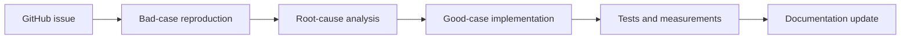
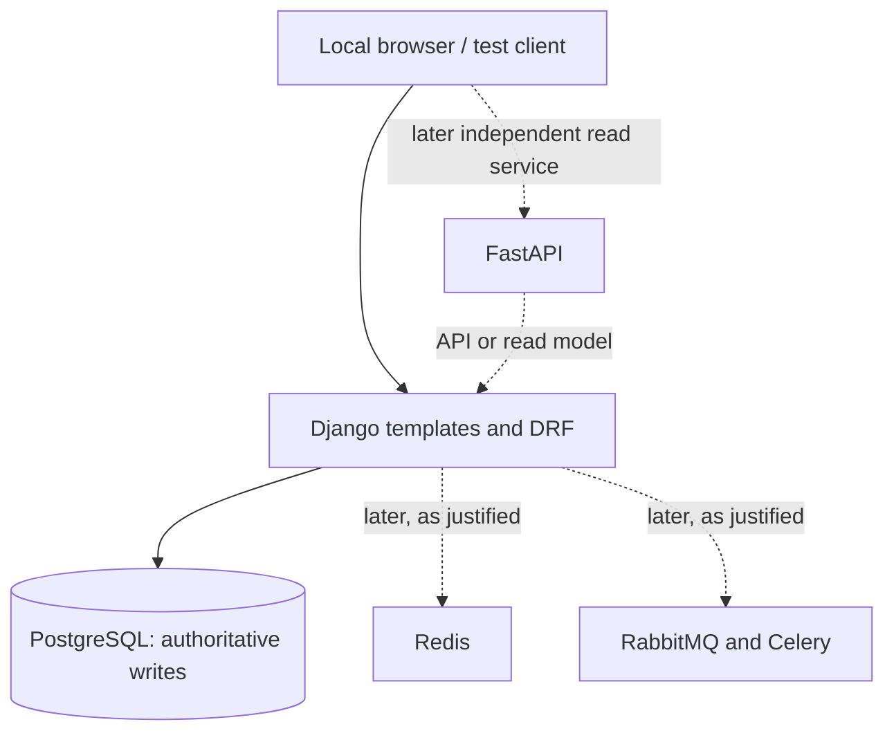

# RaceScale documentation

[Project home](../README.md) | [Blueprint](../PROJECT_BLUEPRINT.md) | [GitHub Issues](https://github.com/ThePardeepHere/RaceScale/issues)

RaceScale teaches production backend engineering with a minimal ticket-booking domain and controlled **bad case / good case** experiments. The goal is to isolate one failure at a time rather than build a complicated ticketing product.

> **Current documentation baseline:** All 46 scenarios are planned. The Django application, test harness, database, and monitoring stack are not yet verified as implemented. A GitHub issue is evidence of a planned task, not of working code.

## Documentation map

| Page | What you will find |
| --- | --- |
| [Architecture](architecture.md) | Planned components, design boundaries, evolution strategy |
| [Local setup](setup.md) | Platform checks, safe local setup, first-run validation |
| [Roadmap](roadmap.md) | Sequence of small milestones and implementation dependencies |
| [Scenario catalogue](scenarios/README.md) | All 46 planned lessons across nine categories |
| [Scenario template](scenarios/TEMPLATE.md) | Required format for bad case, good case, trade-offs, tests, evidence |
| [Testing and benchmarks](testing.md) | Correctness tests, fault injection, load-test methodology |
| [Development and Git workflow](workflow.md) | Small-step workflow, branches, PRs, acceptance criteria |
| [Project blueprint](../PROJECT_BLUEPRINT.md) | Long-term detailed specification and Codex execution contract |

## Scenario lifecycle

Each stage can be a separate focused PR. **Verified** means an actual runnable implementation and supporting evidence exist. It does not mean a scenario was merely documented or an issue was closed.

## Planned system evolution

This is a **target design**, not an assertion that the components exist today. Django owns initial booking writes and their database invariants. FastAPI must not independently mutate those same tables.

## Documentation conventions

- Keep the [root README](../README.md) short and navigational. Keep explanation here rather than creating a Wiki.
- Keep issue state in GitHub Issues, source and tests in the codebase, and explanations in `docs/`.
- Link to scenario-specific source, tests, trace captures and benchmarks only after those artifacts exist.
- Avoid 46 placeholder implementation directories. Category indexes and tickets are sufficient until a scenario starts.
- Update the relevant documents in the **same PR** as a behavior or architecture change. Never publish fabricated performance results.
- Use Markdown relative links for committed documentation. Reference stable GitHub issue URLs for planned work.
