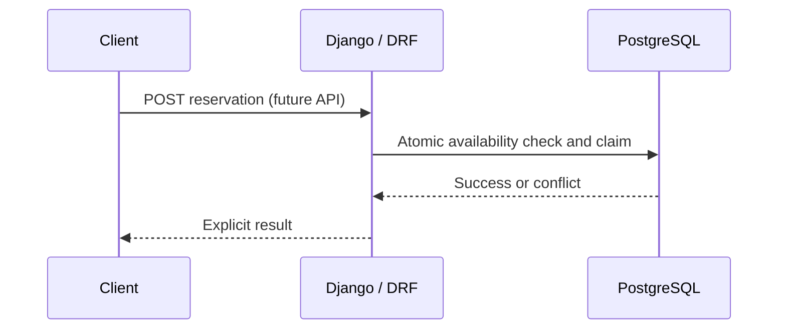

# Architecture and project scope

[Documentation home](README.md) | [Scenarios](scenarios/README.md) | [Workflow](workflow.md)

## Why this domain?

RaceScale uses a small **event ticket-booking** domain. The basic operation is simple: list events and seats, reserve a seat, confirm or cancel a reservation. The engineering challenge is ensuring that those operations remain correct when multiple requests, retries, worker failures, and infrastructure changes occur.

**Invariant examples:** The same seat cannot be confirmed for two bookings. A retry of the same accepted booking operation must not create a second booking. Cache data must not override PostgreSQL's final booking decision.

## Architecture by stage

| Stage | Planned components | Reason to introduce them |
| --- | --- | --- |
| Initial baseline | Django, DRF, PostgreSQL, minimal tests | Establish business rules and reproduce a real race condition |
| Learning dashboard | Django templates, optional HTMX | Display scenario metadata, failures, fixes, and verified evidence |
| Caching | Redis | Repeated reads, stale data, stampedes, outage handling |
| Background work | RabbitMQ, Celery | Delivery, retries, worker failures, outbox |
| Independent service | FastAPI | Show network boundaries, async I/O, timeout and failure isolation |
| Performance engineering | Locust or k6, NGINX, optional PgBouncer | Measure bottlenecks, admission control and scaling |
| Observability | Prometheus, Grafana, tracing | Understand p95 latency, errors, failure paths and recovery |

**Status:** These are planned milestones. A component is not considered running until a relevant issue is implemented and verified.

## Boundary rules

- Begin with **one modular Django application**, rather than prematurely introducing distributed services.
- Django owns the booking write model and PostgreSQL transactions.
- Introduce FastAPI later as an independently running service with an explicit API contract. It should not independently mutate Django-owned tables.
- PostgreSQL constraints and transactions enforce correctness. Redis caches and distributed coordination are supporting mechanisms, not replacements for authoritative writes.
- Failures and unsafe implementations should run only against isolated local test data with explicit safeguards.

## Data and service flow

The diagram is conceptual. Request schemas, transaction boundaries, and endpoint names are finalized in their respective implementation issues.

## What is intentionally outside the first milestone?

Real payments, cloud deployment, Kubernetes, complex authentication, multi-region replication, and production-scale performance claims. These are not needed to teach the first race-condition lesson.

For the full long-term architecture and scenario contract, consult the [root project blueprint](../PROJECT_BLUEPRINT.md). The source-backed task list is in [GitHub Issues](https://github.com/ThePardeepHere/RaceScale/issues).
